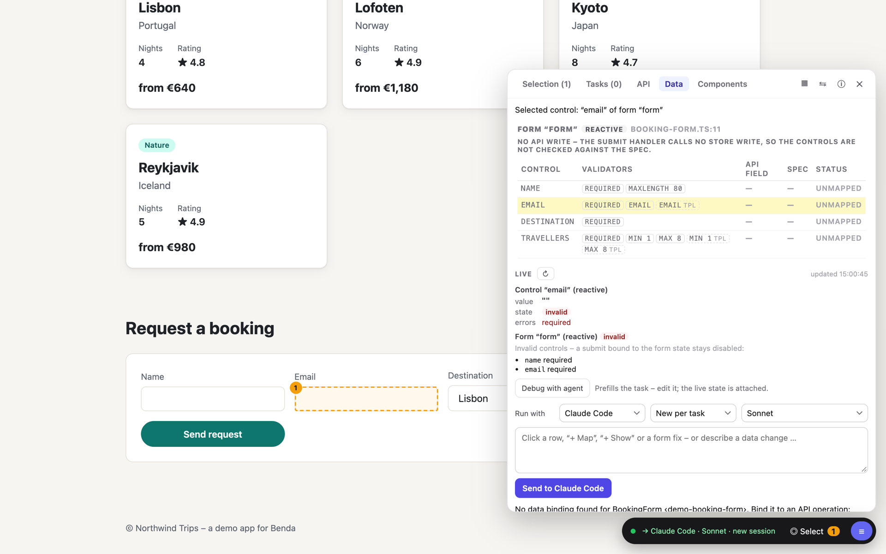

# Work with data

The **Data** tab shows, for the selected element:

- **Lineage:** the chain component → store → API operation → mapper, for every store the component uses, and the
  store's writes (store method → operation via the write mapper). When the data comes from an outer component, both
  are shown.
- **Mapping:** UI ↔ model ↔ API field with the conversion on read and on write. **+ Show** puts a model field on the
  screen, **+ Map** maps an API field into the model, **+ Map on write** sends a request field the app does not write
  yet. Clicking a row prefills a task about that mapping.
- **Forms:** every form of the component with its controls, their validators (in code and in the template), the API
  field each one writes and that field's rules in the spec. Deviations are marked – a missing `required`, a different
  `maxLength`, a required request field without a control – and **+ Validator**, **+ Control**, **Fix** or
  **Fix all** prefill the task that fixes them. A form that writes to no API gets an operation picker and
  **Let AI propose a form**.
- **Live:** what the running app does. The last requests of each operation with status, time, size and the
  violations of the spec found in the response; the state of the selected control, the form (why submit is
  disabled) and the store's signals and resources; the real values of the selected item next to the API values they
  came from. **Simulate** answers an operation with a 2 s delay, an empty list, a 500 or a 4xx error built from the
  spec, without touching your backend, until you switch it off; a banner shows active simulations. **Debug with
  agent** prefills a task, and every Data task carries the live state.
- **Unbound elements:** pick a spec operation and **Let AI propose a mapping** (or **a form**, for operations that
  write). The agent only analyses; you edit the proposed table and then **Implement mapping** / **Implement form**.

The **API** tab lists the OpenAPI specs in your spec folder with their versions; search operations, schemas and
fields; add a spec or a new version (with a diff against the previous one); see which version a client is generated
from (●) and regenerate it. Benda detects orval and openapi-generator configurations. **Impact on the app** compares
two versions – by default the generated one and the one you selected or just added – and lists, grouped as
**Breaking**, **Changed** and **New in the API**, the mappers, store calls and form controls they affect.
**Migrate mapping to <version>** sends one task: switch the generator to that version, regenerate, fix the listed
places, map new fields only where the UI needs them, and run the mapper tests and `npx benda check`.

`npx benda check` runs the same analysis over the whole workspace without the browser: components that import the
generated client, stores whose loading or error state is never rendered, untested mappers, request fields no mapper
writes, form validators that differ from the spec (controls whose value reaches no API are skipped), calls to
operations the spec no longer has. It exits with 1 when a finding reaches `--level` (default `error`), so it fits
into CI.

The Data tab follows a layered data architecture (generated client → mapper → store → component). The rules are in
`skill/references/data-layer.md` of the Benda repository.
