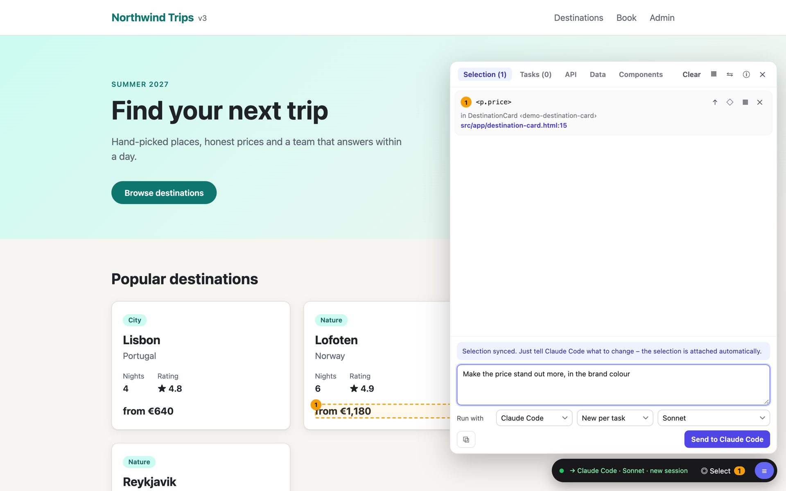

# Designing with Benda



## Select

| Action                                        | Key / control                                |
| --------------------------------------------- | -------------------------------------------- |
| Start / stop selecting                        | **⌥⇧C** (Alt+Shift+C) or **◎ Select**         |
| Select while the key is held (macOS)          | hold **⌥**                                   |
| Select an element                             | click                                        |
| Add or remove an element                      | **⇧**-click                                  |
| Parent / back to the child while hovering     | **↑** / **↓**, then click or **↩**           |
| Parent element, whole component, remove       | **↑**, **◇**, **✕** next to an item in the panel |
| Stop selecting / close the panel              | **Esc**                                      |

## Describe the change

- **In Claude Code:** just type what you want ("make this more compact"). The selection is attached to that prompt.
- **In the browser:** type the task in the panel and click **Send to Claude Code** (or **⌘↩** / **⌥↩**). This reaches Claude
  immediately when the **watch mode** runs; ask Claude to "start the Benda watch mode" (it runs `npx benda wait` in
  the background). The toolbar shows **→ Claude Code · … · listening** while it is active. Without it, the task waits and is
  attached to your next prompt in Claude Code.
- **Several tasks:** you do not have to wait for the agent. Select the next elements, describe the change and click
  **Queue for …** – the task waits in the **Tasks** tab and starts as soon as the one before it is finished. Tasks run
  one after another, also across agents; the tab shows their progress, the agent's summary or error, and lets you
  cancel a task or run it again.
- **Without a selection:** describe the change and send it; the task then applies to the page you are on, and the
  agent gets its URL – e.g. "add a filter above the table".
- **Run with** chooses the harness, the session and the model; the toolbar shows the same (see
  [Sessions](#sessions)).
- **With a template:** pick one under **Template** (e.g. "Restyle") and send, with or without extra text. The next task
  starts without a template again. Templates come from your [configuration](configuration.md#project-rules-and-templates).
- **With skills:** type **/** in the text field to pick a skill the agent can load, e.g. your project's design system
  skill. The task names it, and the agent loads it itself. **Run with** decides which skills are offered: a skill the
  newly chosen agent cannot load is removed again (see [Skills](configuration.md#skills)).
- **With tags:** type **#** to add text you configured, e.g. `#sub-agents` for "use sub-agents where it helps"
  (`ng add` sets up this one). Unlike a template, a task can have any number of tags.

Skills and tags appear as chips below the text field and go with the task, like the text; the template stays chosen.

The toolbar shows the progress; **✓ Done** means the page has reloaded with the change. **⧉** left of the send
button copies the context block, for use with any other agent.

## Sessions

Under **Run with**, the second field decides where a task runs:

| Session           | Harnesses             | What happens                                                                         |
| ----------------- | --------------------- | ------------------------------------------------------------------------------------ |
| **This terminal** | Claude Code           | your Claude Code session takes the task (watch mode or next prompt); it keeps the whole conversation, and its model is the session's (`/model`) |
| **New per task**  | Claude Code, OpenCode | the bridge starts the agent for every task with a fresh context – best for independent changes |
| **Shared**        | Claude Code, OpenCode | the bridge continues one session per harness across tasks, so "a bit larger still" works; **↺** starts a new one when it gets long or goes astray |

Runs the bridge starts need no watch mode and show their summary in the **Tasks** tab. Nobody can answer questions
there, so Claude Code runs with `claude.permissionMode` (default `acceptEdits`: it edits files without asking, shell
commands only as allowed in `claude.allowedTools`, plus Benda's own `npx benda proposal`, `npx benda check` and `npx benda components`). They use your Claude Code login and count towards its limits. For
small local models, prefer **New per task**: a shared session fills their context quickly.

## Use a local model

Choose **OpenCode** and a model under **Run with** in the panel. The bridge runs the task with `opencode run` and shows its
progress and summary; no Claude session is involved. Setup and a local-only configuration without Claude Code: see
[Use Benda without Claude](local-ai.md). To pick a default for one session only:

```bash
BENDA_DEFAULT_AGENT=opencode:ollama/qwen3.8:27b npm run dev
```
