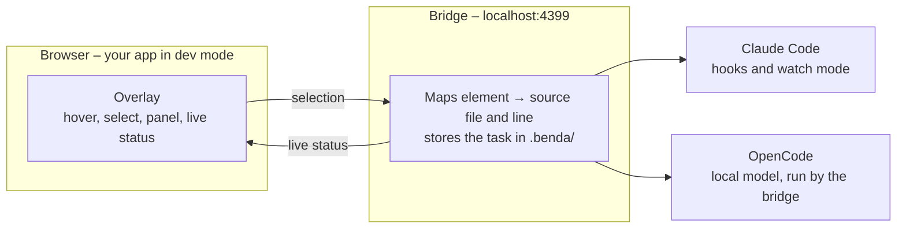

# How it works



1. **Load.** In dev mode your app loads the overlay from the bridge (`loadBenda()` in Angular). The overlay lives in
   a shadow DOM, so it neither picks up nor changes your app's styles.
2. **Select.** Press **⌥⇧C** or hold **⌥** (Windows/Linux: **Alt+Shift+C**) and click an element. The framework adapter identifies
   the component that declares it, and the bridge looks up the source file and the template line that most likely
   contains it.
3. **Hand over.** The selection reaches the agent as a Markdown context block:

   ```markdown
   ## Benda – selection from the browser (1 element)
   **Task from the browser:** make the number bigger
   Page: http://localhost:4300/dashboard · viewport 1440×900

   ### 1. <p class="mt-2 text-3xl font-semibold tracking-tight">
   - **File to edit:** `projects/mfe-dashboard/src/app/dashboard/kpi-card.ts` – likely line(s): 15 `<p class="mt-2 text-3xl …">{{ kpi().value }}</p>`
   - Declared in the template of: `KpiCard` <dashboard-kpi-card>
   - Project / micro frontend: `mfe-dashboard`
   - Component path: shell-root › dashboard-page › dashboard-kpi-card
   - Computed: display: block; font-size: 30px; font-weight: 600; color: rgb(15, 23, 42)
   ```

   In your **Claude Code terminal session**, a `UserPromptSubmit` hook attaches the block to your next prompt, or – in
   watch mode – a background `benda wait` hands a task sent from the browser to Claude right away. Otherwise the
   bridge runs the agent itself: `claude -p` or `opencode run`, with a new session per task or one shared session.
4. **Edit and reload.** The agent edits the file. A `PreToolUse` hook streams each step to the overlay, the `Stop`
   hook reports "✓ Done" with Claude's summary, and the dev server reloads the page. The selection survives the reload.

Benda is split into a framework-independent core (`@strokkur/benda`: bridge, overlay, CLI, agent runners, network
capture, OpenAPI validation) and a framework adapter (`@strokkur/benda-angular`: component lookup, source index, data
lineage, form analysis, installer).

## Packages

| Package                                     | Contents                                                       |
| ------------------------------------------- | -------------------------------------------------------------- |
| `@strokkur/benda`        | bridge, overlay with network capture, `benda` CLI, Claude Code hooks, runner (Claude Code, OpenCode), OpenAPI index (diff, validation, simulation) |
| `@strokkur/benda-angular` | Angular adapter (source index, data lineage, forms, live state, check, impact), `loadBenda()`, `ng add` installer |
