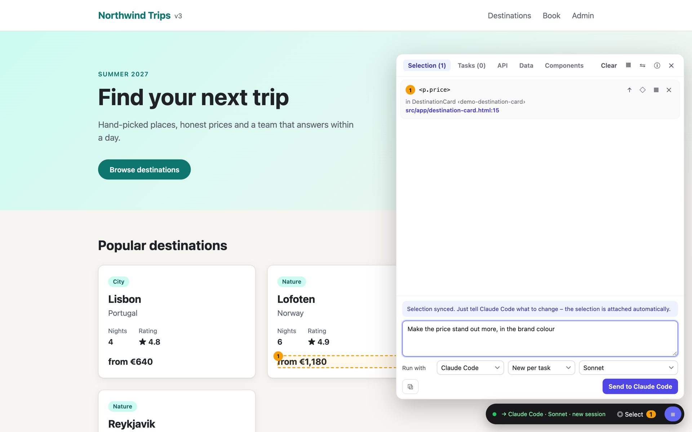
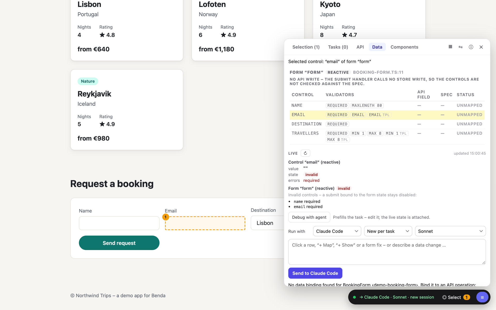
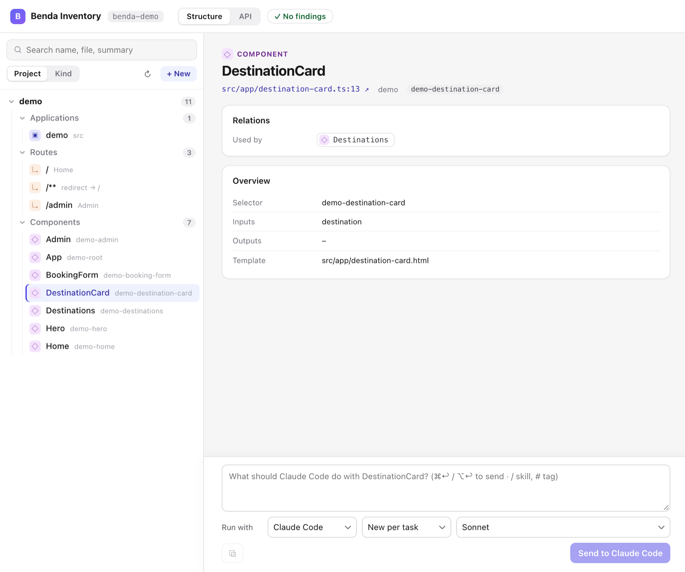

---
hide:
  - navigation
  - toc
---

<div class="benda-hero" markdown>

# Point at it. Your agent changes it.

Benda (Icelandic for "to point") puts a small overlay into your app while it runs in development. Click the button,
card or table cell you want to change, say what should be different, and your coding agent edits the right file and
line. The dev server reloads, and you see the result where you asked for it.

[Get started](getting-started.md){ .md-button .md-button--primary }
[How it works](how-it-works.md){ .md-button }

</div>

<video class="benda-shot" src="assets/select.webm" poster="assets/select.png" autoplay loop muted playsinline></video>

## What it does

<div class="grid cards" markdown>

-   :lucide-crosshair: **Precise**

    The agent gets the selected element with its component, source file, likely template line, computed styles and
    HTML – no hunting for "the blue button on the dashboard".

-   :lucide-bot: **Works with your agent**

    [Claude Code](https://claude.com/claude-code) in your terminal or run by Benda, or a local model through
    [OpenCode](https://opencode.ai). Each task starts fresh or continues a shared session.

-   :lucide-activity: **Live feedback**

    While the agent works, the overlay shows the elapsed time and its current step, and the selected elements pulse
    until it is done.

-   :lucide-database: **Data-aware**

    The Data tab traces an element's data from component to API, checks forms against the spec and simulates slow,
    empty or failing responses.

-   :lucide-layout-grid: **Workspace inventory**

    Every route, component, store and API client of your workspace on one page – change or create building blocks
    from there.

-   :lucide-shield-check: **Development only**

    The overlay is served by a local bridge and loaded only in dev mode. Production builds never contain it.

</div>

## See it in action

=== "Select and describe"

    

=== "Data tab"

    

=== "Inventory"

    

## Quick start

In the root of your Angular workspace:

```bash
npx ng add @strokkur/benda-angular
npm run dev
```

Open the app, start Claude Code in the project folder, and press ++alt+shift+c++ in the browser.
[Getting started](getting-started.md) has the details, [Use Benda without Claude](local-ai.md) the setup for a local
model.

Supported today: **Angular**, including micro frontends with Native Federation. Vue and React are planned.
