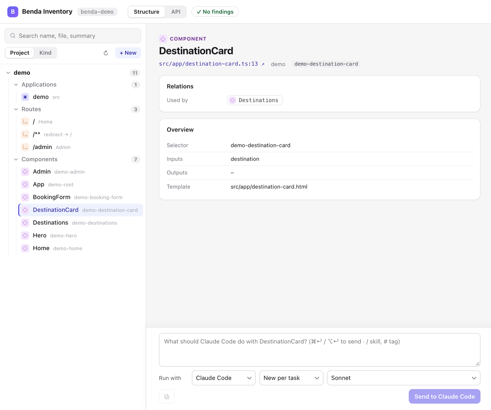

# Benda Inventory

`http://localhost:4399/inventory` (the bridge's port) shows the building blocks of the whole workspace – for Angular:
applications, routes (into the micro frontends, too), components, directives, pipes, stores, services, mappers,
models, guards, resolvers, interceptors and the generated API clients. **▦** in the overlay's panel opens it, and **▦**
next to a selected element jumps to its component there.

- **Tree:** by project and feature folder, or by kind (**⇄**); the search covers names, files and summaries.
- **Details:** file and line (a link opens it in your editor), what the block uses, injects, routes to, reads and
  writes, and what uses, injects or routes to it – plus details per kind, e.g. a store's operations with their
  mappers, a component's inputs, outputs and data.
- **Change it:** describe the change below the details and send it, with the same **Run with**, sessions, skills and
  tags as in the overlay. The agent gets the block with its relations as context. The **Tasks** column shows the
  queue of both, the page and the overlay. When source files change – through an agent, the editor or git – the page
  reads the workspace again; a renamed block stays selected.
- **Checks:** the top bar counts the findings of `npx benda check`; a dot in the tree marks the blocks they concern,
  their details list them, and **Fix** (or **Fix all**) queues a task with the finding and the block. **●** in the
  top bar lists every finding of the workspace. A component's details also show its forms – each control's API
  field, validators and status, as in the Data tab.
- **Create:** **+** on a project, folder or kind (or **+ New**) asks for the kind, the place – an existing folder or a
  new one – and the kind's fields, e.g. a component's route path. The agent creates it following an existing one of
  the same kind, preferably from the same folder. A **store** starts with the API: pick the spec, its operations and
  the components to use it in; the agent first proposes the UI model, the store methods and the files, you edit the
  proposal on the page, and **Implement** builds it – model, mapper with tests, store – following the data-layer
  rules.
- **API:** the overlay's API tab, full size. After **Impact on the app**, ⚑ in the tree marks the blocks a new API
  version breaks or changes, and their details list how.

The page reads the workspace statically on every visit and caches it per file, so it stays current while you or the
agent edit. Without an adapter that supports it (`inventory()`), it says so.
